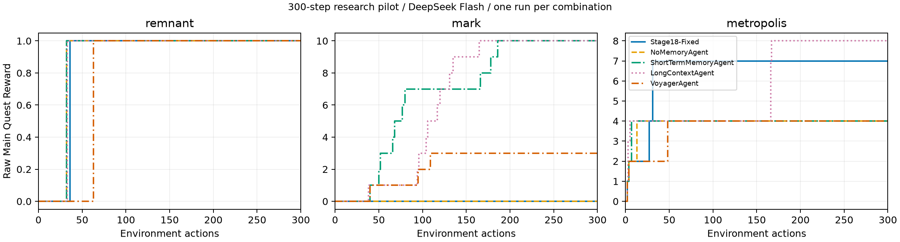
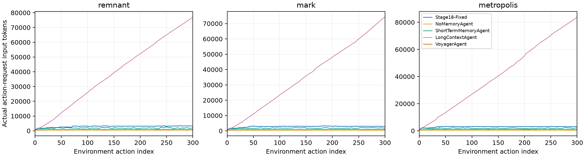

# 三游戏五算法完整结果

**300 步 / DeepSeek Flash / 非 TTCL 正式排名。每组合一次，全部保留。**

**配对限制：官方初始化没有固定进程哈希种子，metropolis 的主线地点参数也存在差异；分差不是严格同状态的算法因果效应。详见运行事件审计。**

| 游戏 | 方法 | 主线 | 支线 | 探索 | 制作 | 战斗(唯一) | 辅助总和 | 动作 | 终止 |
| --- | --- | --- | --- | --- | --- | --- | --- | --- | --- |
| remnant | Stage18-Fixed | 1 | 0 | 2 | 0 | 3 | 5 | 300 | step_limit |
| remnant | NoMemoryAgent | 1 | 0 | 2 | 0 | 6 | 8 | 300 | step_limit |
| remnant | ShortTermMemoryAgent | 1 | 0 | 2 | 1 | 1 | 4 | 300 | step_limit |
| remnant | LongContextAgent | 1 | 0 | 2 | 0 | 1 | 3 | 300 | step_limit |
| remnant | VoyagerAgent | 1 | 1 | 2 | 0 | 3 | 6 | 300 | step_limit |
| mark | Stage18-Fixed | 0 | 0 | 1 | 0 | 2 | 3 | 300 | step_limit |
| mark | NoMemoryAgent | 0 | 0 | 2 | 0 | 7 | 9 | 300 | step_limit |
| mark | ShortTermMemoryAgent | 10 | 0 | 9 | 4 | 8 | 21 | 300 | step_limit |
| mark | LongContextAgent | 10 | 0 | 5 | 4 | 5 | 14 | 300 | step_limit |
| mark | VoyagerAgent | 3 | 0 | 2 | 2 | 3 | 7 | 300 | step_limit |
| metropolis | Stage18-Fixed | 7 | 0 | 2 | 1 | 1 | 4 | 300 | step_limit |
| metropolis | NoMemoryAgent | 4 | 2 | 3 | 0 | 2 | 7 | 300 | step_limit |
| metropolis | ShortTermMemoryAgent | 4 | 4 | 5 | 0 | 1 | 10 | 300 | step_limit |
| metropolis | LongContextAgent | 8 | 2 | 8 | 0 | 1 | 11 | 300 | step_limit |
| metropolis | VoyagerAgent | 4 | 1 | 3 | 0 | 0 | 4 | 300 | step_limit |

## 官方三游戏无权平均

| 方法 | 主线均值 | 辅助总和均值 | 环境done局数 |
| --- | --- | --- | --- |
| Stage18-Fixed | 2.666667 | 4.000000 | 0/3 |
| NoMemoryAgent | 1.666667 | 8.000000 | 0/3 |
| ShortTermMemoryAgent | 5.000000 | 11.666667 | 0/3 |
| LongContextAgent | 6.333333 | 9.333333 | 0/3 |
| VoyagerAgent | 2.666667 | 5.666667 | 0/3 |

各方法的未修改官方脚本输出在 `results/stage22/official_scores/`；主要排序只看原始主线均值，并列才看辅助总和均值。不按动作成本或归一化奖励重新排名。

## 成本、效率及异常

| 游戏 | 方法 | API请求 | 输入token | 输出token | usage计价美元 | 官方无效动作 | 反馈拒绝次数 | 重复检查 | 最长连续wait | 最长输入token |
| --- | --- | --- | --- | --- | --- | --- | --- | --- | --- | --- |
| remnant | Stage18-Fixed | 300 | 875874 | 25010 | 0.140705 | 0 | 9 | 2 | 44 | 3399 |
| remnant | NoMemoryAgent | 300 | 156916 | 22848 | 0.031564 | 9 | 39 | 3 | 1 | 692 |
| remnant | ShortTermMemoryAgent | 300 | 545523 | 31785 | 0.094163 | 4 | 60 | 3 | 1 | 2664 |
| remnant | LongContextAgent | 300 | 11686283 | 31337 | 0.081503 | 0 | 23 | 0 | 1 | 77121 |
| remnant | VoyagerAgent | 698 | 519011 | 52751 | 0.088447 | 1 | 110 | 26 | 1 | 2933 |
| mark | Stage18-Fixed | 300 | 852830 | 21639 | 0.135263 | 0 | 2 | 5 | 27 | 3259 |
| mark | NoMemoryAgent | 300 | 152763 | 22777 | 0.030898 | 15 | 82 | 8 | 1 | 622 |
| mark | ShortTermMemoryAgent | 300 | 528774 | 24737 | 0.087460 | 0 | 54 | 0 | 1 | 2197 |
| mark | LongContextAgent | 300 | 10792906 | 25936 | 0.075234 | 3 | 45 | 1 | 1 | 74276 |
| mark | VoyagerAgent | 712 | 538289 | 53033 | 0.092844 | 1 | 108 | 33 | 1 | 3089 |
| metropolis | Stage18-Fixed | 300 | 894688 | 21735 | 0.141599 | 0 | 6 | 0 | 98 | 3315 |
| metropolis | NoMemoryAgent | 300 | 155533 | 24247 | 0.032177 | 4 | 46 | 37 | 1 | 706 |
| metropolis | ShortTermMemoryAgent | 300 | 547210 | 27785 | 0.092280 | 1 | 50 | 5 | 1 | 2290 |
| metropolis | LongContextAgent | 300 | 12480528 | 34494 | 0.087004 | 2 | 62 | 0 | 3 | 83903 |
| metropolis | VoyagerAgent | 656 | 510474 | 55373 | 0.084920 | 6 | 121 | 14 | 1 | 3343 |

官方无效动作严格取环境 info 标志；反馈拒绝是文本筛查，二者不可互换。重复检查指再次检查相同对象，可能具有重新确认库存的合理用途，不能全部算浪费。费用按请求返回的缓存命中、输入输出 usage 与核验价目计算，不冒充账户发票。

保留 11 条异常请求索引，详见 `model_anomalies.json`。没有为了格式或结果重新抽样；官方 parser 的 fallback 行为保留。Voyager 所有额外角色调用计入请求数和成本。

| 游戏 | 方法 | 总时长秒 | 决策累计秒 | 输入缓存命中率 | 动作/其他角色调用 |
| --- | --- | --- | --- | --- | --- |
| remnant | Stage18-Fixed | 444.6 | 401.2 | 4.41% | {"action": 300} |
| remnant | NoMemoryAgent | 389.7 | 366.0 | 24.63% | {"action": 300} |
| remnant | ShortTermMemoryAgent | 445.3 | 420.8 | 8.40% | {"action": 300} |
| remnant | LongContextAgent | 469.7 | 444.8 | 98.39% | {"action": 300} |
| remnant | VoyagerAgent | 2264.0 | 2183.3 | 27.60% | {"curriculum": 59, "action": 300, "critic": 299, "skill_distillation": 40} |
| mark | Stage18-Fixed | 414.0 | 375.3 | 4.50% | {"action": 300} |
| mark | NoMemoryAgent | 383.7 | 362.4 | 25.30% | {"action": 300} |
| mark | ShortTermMemoryAgent | 393.9 | 370.2 | 8.62% | {"action": 300} |
| mark | LongContextAgent | 421.4 | 398.4 | 98.28% | {"action": 300} |
| mark | VoyagerAgent | 2243.1 | 2150.7 | 24.92% | {"curriculum": 66, "action": 300, "critic": 299, "skill_distillation": 47} |
| metropolis | Stage18-Fixed | 861.9 | 377.8 | 4.29% | {"action": 300} |
| metropolis | NoMemoryAgent | 809.7 | 373.4 | 24.94% | {"action": 300} |
| metropolis | ShortTermMemoryAgent | 810.6 | 373.2 | 8.05% | {"action": 300} |
| metropolis | LongContextAgent | 944.3 | 458.8 | 98.43% | {"action": 300} |
| metropolis | VoyagerAgent | 2688.6 | 2247.1 | 33.15% | {"curriculum": 39, "action": 300, "critic": 299, "skill_distillation": 18} |

总时长包含加载、CPU 检索、暂停恢复及并发竞争；决策累计时长包含模型和检索。它们不是隔离硬件下的速度基准。输入缓存命中率使用真实 API usage。

## 进度与上下文

PDF 与可重算 CSV 同时保存。重叠曲线可能遮盖彼此，逐步精确数值以 CSV 为准。所有请求上限相同，LongContext 没有专属截断、摘要或提高额度。
