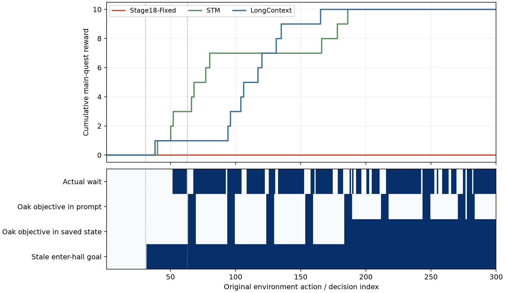

# mark 环境失败案例分析

**最终分类：DESIGN_LIMIT。** 当前直接证据指向过期目标及围绕该目标工作的控制与记忆表示；未确认会丢弃 observation、动作或已保存记忆的运行时故障。保持 Stage18-Fixed 及所有既有轨迹不变，本轮没有新模型请求、正式重跑或补丁版。

指引中“LongContext 成功完成 mark”需限定为**拿到 10 个主线阶段奖励并完成第一章**。STM、LongContext 在 a300 的 `main_quest_progress.complete` 均为 false，不能写成全游戏通关。

| 方法 | 主线奖励 | 第一章完成 | 全主线完成 | 实际动作 | wait | 最长连续 wait | 教程结束 |
| --- | --- | --- | --- | --- | --- | --- | --- |
| Stage18-Fixed | 0 | 未达 | False | 300 | 190 | 27 | 31 |
| STM | 10 | 186 | False | 300 | 2 | 1 | 28 |
| LongContext | 10 | 165 | False | 300 | 1 | 1 | 28 |

## 冻结范围与审计完整性

来源为 Stage22 提交 `4696a5ce734f9cfbf4c99c39e52412f43c0cd3be`，引擎 `248430692a9d4a61d38c6c03ab2126287faaf450`。4368 个已有项目文件及 278 个官方源码文件按 SHA-256 核验不变。三方法各 300 步，共 900 步的 observation、原回复、动作、完整保存状态、历史动作和公开物品/位置变化已整理。使用原回复重构时，900 次请求上下文与动作逐字相同，三个最终记忆及 save/load 回环一致。未观察到的 LLM 隐状态不在审计能力内。

原生全状态严格回放：Stage18 300、LongContext 300、STM 224，共 824 步。STM a225 反馈、奖励、done 相同但全状态哈希不同，随后 76 步只使用原始公开轨迹与精确重构的 Agent 状态，隐藏世界变化标为不可用。未固定 Python 哈希顺序是既有可重复性风险，不能未经隔离就认定本次差异的唯一原因。分析器曾修正深拷贝归档，事件保存在 `analysis_events.json`；最终统计使用不可变快照核验后的回放，保留失败结果。

完整字段和逐行索引见 [step_ledger.csv](../../results/stage22b/step_ledger.csv)、[evidence_index.csv](../../results/stage22b/evidence_index.csv)。公开容器数量是最后一次可见记录，不能当成隐藏当前库存。基线没有结构化目标字段；“最新公开指令”“事后环境阶段”“模型 reasoning”分别记录，不把其中任何一项伪称为 LLM 的真实内部目标。

## 失败如何形成

1. 教程 a30 要求 `enter hall`，a31 正确进入大厅并收到 `Tutorial Finished.`；此后旧目标一直保留到 a300。a31–300 同一目标持续 270 次决策，其中 a32–300 共 269 次已过期。
2. a32 在 library 看见 oak_log 和主动提醒任务的 remy。a33、a35 原模型提议 `talk to remy`，控制器改为 `enter hall`。两条同状态原生反事实都能当场取得 oak_rod 指令，确认的是局部知识机会损失，不是整局 10 分的因果解释。
3. a37 拾取 paper_0，a40 拾取 goblin_token，双手被占。a41–50 改做检查，a51 尝试进入锁住的 armory，a52–62 连续 wait。
4. a63 终于与 remy 对话，公开 “Craft an oak rod” 和所需 oak_log。但目标字段仍是 `enter hall`，a65、a67 的拾取提案又有真实手部容量障碍，缺少先腾出手再取材的有效执行。
5. a68、a69 原模型提出进入 library，控制器保留 wait；至 a70，第一次任务指令已从 STM5 与其他当时保存状态中消失。后续重复获知任务也未改变目标。
6. a183 的任务对话因同时出现受伤而进入后果记录，之后可以在保存状态找到指令，但事实摘要未将它作为当前目标送入模型。持续保存本身没有解决决策触发。

对应原文：[a31](关键证据原文.md#stage18-fixed-a031), [a32](关键证据原文.md#stage18-fixed-a032), [a33](关键证据原文.md#stage18-fixed-a033), [a35](关键证据原文.md#stage18-fixed-a035), [a40](关键证据原文.md#stage18-fixed-a040), [a63](关键证据原文.md#stage18-fixed-a063), [a65](关键证据原文.md#stage18-fixed-a065), [a67](关键证据原文.md#stage18-fixed-a067), [a68](关键证据原文.md#stage18-fixed-a068), [a70](关键证据原文.md#stage18-fixed-a070), [a183](关键证据原文.md#stage18-fixed-a183), [a200](关键证据原文.md#stage18-fixed-a200), [a300](关键证据原文.md#stage18-fixed-a300)。

图下半部逐决策展示原始事实；蓝色表示该条件成立。模型输入中的任务指令只按明确原文定位，不代表模型的潜在理解。上下两部分均来自原轨迹，没有用分支结果替换实际分数。

## 首次不可恢复错误：当前证据不能定位

最早清楚的教程后表示偏差是 a32 仍保留已完成的 `enter hall`；最早有同状态证据的主线信息获取损失是 a33。这两者都不是已经证明的不可恢复状态。用预登记的七个实际状态做公开信息人工诊断路径，均能取得第一阶段奖励：

| 原动作前 | 剩余原预算 | 分支动作 | 增加主线奖励 | 仍在原预算内 |
| --- | --- | --- | --- | --- |
| 33 | 268 | 5 | 1 | True |
| 35 | 266 | 5 | 1 | True |
| 65 | 236 | 6 | 1 | True |
| 67 | 234 | 6 | 1 | True |
| 100 | 201 | 7 | 1 | True |
| 271 | 30 | 7 | 1 | True |
| 300 | 1 | 7 | 1 | False |

这些路径只使用已公开的 NPC 指令、可见物品和此前看见的两个房间；必要时先 drop 腾出手，再取 oak_log、回 workbench、craft 并拾取 oak_rod。a33/a35 的首步沿用原 LLM 对话提案。每条分支从完全相同的物理状态和 RNG 状态出发，并确认未改动正式回放父状态。所有七条分支都保留，详见 [完整分支](../../results/stage22b/public_recovery_witnesses.jsonl.gz)。

这只是“第一阶段仍可达”的存在性证据，不是自动 Agent 的表现，不是 Stage18-Fixed-Patched 的 A/B，也不证明余下整条主线能在原 300 步内完成。a300 的 7 步分支超出原剩余 1 步，单独标注，不能计作原预算内恢复。没有遍历整条任务图或证明最短剩余路径，因此不声称找到了首次全任务不可恢复错误。

## 状态滞留与探索

| 指标 | Stage18 | STM | LongContext |
| --- | --- | --- | --- |
| wait 总数 | 190 | 2 | 1 |
| wait 连续块数 | 22 | 2 | 1 |
| 连续 ≥5 步 wait 块数 | 12 | 0 | 0 |
| 这些长 wait 块消耗动作 | 164 | 0 | 0 |
| 最长 wait | 27 | 1 | 1 |
| 相邻同动作重复次数 | 179 | 9 | 15 |

Stage18 190 次 wait 中，原 LLM 仅提议 wait 2 次，其余 188 次由覆盖产生；总覆盖 214/300。12 个长 wait 段消耗 164 步，最长 a216–242 共 27 步。全 300 次决策 FIFO 均为空，exploration_spent 最大为 0，**不是 FIFO 堵塞或探索额度耗尽**。同动作/周期重复只是机械计数，连续攻击可能必要，不能一律判为浪费。

256 次决策中人已经在 hall，`get_goal_status()` 仍按“持有 hall 物品至少 1 个”返回 complete=false。这是制作物品式目标表示用于移动任务的语义失配，不是世界没有上报位置。非教程区域访问数为 Stage18 2、STM 10、LongContext 6。Stage18 已到过取材 library，也看过 hall 的工作台，所以第一阶段不能归因为没有探索到所需房间；更晚的区域缺失与第一阶段停滞相互关联，不能算成独立根因。

闭环证据为：旧 `enter hall` → hall 被当作物品需求 → 对话/移动不构成 known_goal_progress → 重复候选被限制后 wait → 未推进主线 → 旧目标继续保留。该链由状态与决策日志支持；尚无完整政策消融为各环分配整局因果贡献。
