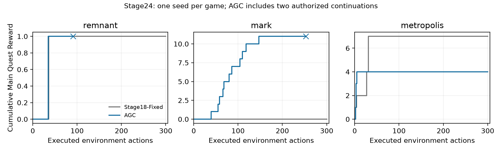

# Stage24 轨迹分析

所有编号为实际环境动作编号 a1 起；“第 92/254 次决策”没有执行环境动作。逐步原始证据可从 [evidence.jsonl.gz](../../results/stage24/evidence.jsonl.gz) 的 game/method/step 定位，完整 observation、模型原提案、重考虑、最终动作、控制状态和环境反馈均在对应 trajectory.jsonl.gz。

## mark：恢复主线，但第二章仍有库存循环

AGC a28 执行 `enter hall` 后完成字面移动目标；a32 `talk to remy` 获得任务提醒，a33–39 制作并收取 oak_rod。旧 Stage18 a31 进入 hall 后仍持有旧目标，a33/a35 原提案对话被覆盖；AGC 本次没有把模型动作替换成 wait。a39 起连续主线里程碑，a118 击败 page_gnawer 完成第一章，a147 到达 crystal_grotto 获得第二章第一个奖励，最终 11 分。两条模型轨迹早已分叉，不能把全部 11 分作为目标状态模块的严格因果增量。

a157–253 持续“Gather 10 coins…”目标 97 步，其中 `pick up coin` 32 次、`drop coin` 31 次，没有新的主线奖励。手持容量约束反复出现；部分模型回复在同一段内反复推理“需要容器但买容器又需要更多钱”。a197 后控制状态变为 SUSPICIOUS，a198–201 进行了四次软限制重考虑后放行；a201 的新观测再次激活目标，未稳定解决数量/容量问题。不能把零 wait 写成没有浪费或控制器完全解决了恢复。

第 254 次决策：两条模型回复都引用 `I see 8 coin near me.`；真实 observation 是包含 berry、oak_log、resin_clump、coin 等项目的完整物品列表。因此它是事实摘要，不是逐字子串，空白规范化仍不会通过。先提 `talk to harper_stone`，再提 `pick up coin`，被硬证据约束终止。同状态原生回放接受首个对话动作并返回商店信息，但主线增量为 0；这是可执行动作被拒的证据，不证明损失了新的信息或最终分数。原始反馈见 [终止动作审计](../../results/stage24/terminal_native_audit.json)，不能据此推断余下整局可完成。

## remnant：解除教程目标后进入任务，仍未解决装备/照明

修复后 a6 使用缓存原回复继续。a26 进入 hall，a35 用 key 解锁 library 得到主线 1，a36 公开指令要求先取得武器。a38–91 的武器目标持续 54 步，包含往返 armory/hall、战斗和照明相关操作；期间两次死亡。a35 之后 56 个实际动作没有主线增量。结尾 a90 进入黑暗 armory，a91 返回 hall。

第 92 次决策两次生成 `write note on paper_7`，公开签名是 `write <text> <writable_name>`；共享语法检查把未加引号的额外 `on` 作为第三个参数拒绝。同状态原生检查也报 requires format / got 3 parameter(s)，说明不是解析器误拒有效语法。无替代动作、无自动 wait，按预登记终止在 91 个已执行动作。该失败不应被包装成充分利用了 300 步，也不能将停止后的未观察路径当作无规划能力的证明。

## metropolis：多动作循环使通用停滞阈值漏检

a5 已拿 evidence_dossier_0 并到达 4 分；a6/a12 进入 evidence_room 未完成交付。a18 得到公开支线提示，a19 模型自行把制作 gavel_club 作为可能帮助主线的支线，原 reasoning 使用 “may provide tools or progress relevant to cataloguing evidence”。控制器没有提供这一规划。

a19/a41 制作缺工作台，a53 缺材料，a55 拾取材料遭手持容量拒绝。a55 的目标加入 iron_filings、marble_chunk，但附带引文只是一份可见物品列表；能核验引文来自环境，不能由此证明这些都是目标必要材料。a82–300 同一目标持续 219 步，四类材料的拾取/丢弃合计 191 次，实际 craft 奖励为 0。a297/a300 又尝试制作原生反馈称无法制作的 iron_filings。

最后一次主线奖励仍是 a5，其后 295 步没有主线增长；第一章未完成，旧 Stage18 则在 a31 达到 7 分并完成第一章。几乎不 wait 的负面局完整保留。

## 对进展代理的审计

| 游戏 | 最长同目标区间 | 长度 | 区间主线增量 | 被记为 informative | 目标 |
| --- | --- | --- | --- | --- | --- |
| remnant | a38–a91 | 54 | 0 | 45 | Find a weapon before following the ash to the Cinder Shrine |
| mark | a157–a253 | 97 | 0 | 48 | Gather 10 coins to buy the Tear of Forest from broker_sera |
| metropolis | a82–a300 | 219 | 0 | 36 | Gather all ingredients for gavel_club: gavel_timber, binding_thread, iron_filings, marble_chunk |

最长区间中，remnant 45/54、mark 48/97、metropolis 36/219 步被记为 informative，但主线增量均为 0。公开新状态、新反馈、战斗/复活与物品变化并不必然与目标相关；多种动作交替也可能达不到“8 步中某一动作至少 5 次”的停滞门槛。额外事后 20 步紧窗口诊断同样没有命中这三段，不能用一个窄指标的零值排除长周期循环。原动作频数与奖励平段提供了更直接的描述证据，见 [全部目标区段](../../results/stage24/trajectory_diagnostics.json)。没有据此修改阈值或重跑。

## 全部主线里程碑

### remnant

| 动作 | 动作文本 | 奖励增量 | 累计主线 |
| --- | --- | --- | --- |
| 35 | enter library | 1 | 1 |

### mark

| 动作 | 动作文本 | 奖励增量 | 累计主线 |
| --- | --- | --- | --- |
| 39 | pick up oak_rod | 1 | 1 |
| 55 | pick up copper_sword | 1 | 2 |
| 58 | enter library | 1 | 3 |
| 66 | write kindness paper_0 | 1 | 4 |
| 68 | enter armory | 1 | 5 |
| 80 | pick up key | 1 | 6 |
| 86 | enter stalls | 1 | 7 |
| 104 | pick up torch | 1 | 8 |
| 110 | enter backstreets | 1 | 9 |
| 118 | attack page_gnawer | 1 | 10 |
| 147 | enter crystal_grotto | 1 | 11 |

### metropolis

| 动作 | 动作文本 | 奖励增量 | 累计主线 |
| --- | --- | --- | --- |
| 2 | enter clerks_office | 1 | 1 |
| 3 | talk to archivist_lune | 2 | 3 |
| 5 | pick up evidence_dossier_0 | 1 | 4 |

## 模型异常和恢复

mark a160、a167、a236 的首回复是只包含 reasoning 的合法 JSON；a161、a206 的首回复达到输出上限并产生不完整 JSON。五处均由原定一次重考虑获得动作，分别执行 enter glade、attack fen_cutthroat_0、drop coin、talk to harper_stone、drop coin（按上述编号对应）。没有扩大输出上限、追加多次重试或替换模型。引文拒绝、语法拒绝与传输/JSON 异常分开计数。
