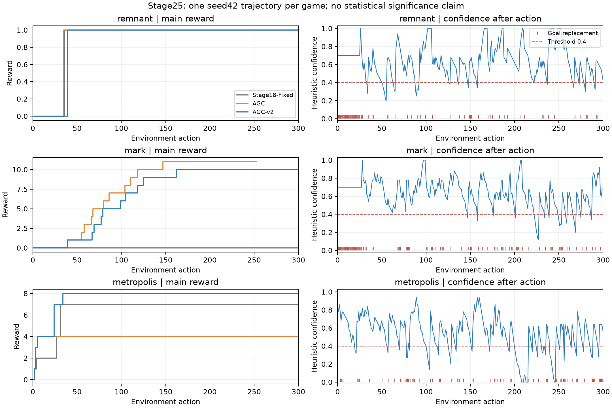

# 置信度与目标重评估分析

图中置信度为执行动作后的数值；红色竖线为实际目标登记替换。PDF同名文件可导出。曲线原始数据逐步保存在 `step_metrics/*AGC-v2.jsonl.gz`，全部增减事件在原轨迹 `control_after.events`。

| 游戏 | 方法 | 平均同文本目标动作 | 替换次数 | 替换后有主线增量窗口 | 全部窗口成功率 | 排除右删失后 | 置信度重评估请求 |
|---|---|---|---|---|---|---|---|
| remnant | AGC | 3.14 | 28 | 1 | 3.6% | 3.6% | — |
| remnant | AGC-v2 | 4.55 | 65 | 1 | 1.5% | 1.6% | 21 |
| mark | AGC | 4.52 | 55 | 11 | 20.0% | 20.0% | — |
| mark | AGC-v2 | 3.26 | 91 | 9 | 9.9% | 10.0% | 20 |
| metropolis | AGC | 23.08 | 12 | 2 | 16.7% | 16.7% | — |
| metropolis | AGC-v2 | 4.76 | 62 | 4 | 6.5% | 6.6% | 53 |

目标平均长度按连续相同目标文本的实际动作数计算。替换包括模型主动换目标、完成后换目标及新公开指令，不等于错误 reset；同义改写也算文本改变。阈值触发重评估不强制清空、不提供新目标。每个环境决策至多一次额外目标重评估，其后允许模型保留合法提案，记录 soft release。

| 游戏 | 低置信度后实际替换 | 其中有主线增量 | 右删失窗口 | 零动作窗口 | 最长同文本目标 | 共同 stale 代理动作 |
|---|---|---|---|---|---|---|
| remnant | 14 | 1 | 1 | 0 | 23 | 2 |
| mark | 15 | 1 | 1 | 0 | 27 | 0 |
| metropolis | 27 | 0 | 1 | 0 | 20 | 3 |

替换后成功窗口定义：替换后到下一次替换前，最多20个实际动作，官方主线增量>0。公开反馈产生的替换从下一动作开始，执行前模型替换从当前动作开始；同一边界替换可能有零动作窗口，仍保留分母。最后不足20步的窗口标为右删失；下一次替换提前结束是预定义竞争结束条件。窗口计数是描述，不是reset因果效应。全部起止、旧/新目标、前后奖励、目标相关事件、字面完成次数见 `metrics.json` 的 `reset_windows`。

共同 stale 代理要求目标连续≥12步且共同公开停滞检测为真，只用于旧新版本一致测量；它不是在线reset规则，也不是完整根因标签。多动作循环、新敌人到来和反复改变目标可能绕过该代理，不能用低 stale 数证明长期规划已经解决。

## 机制证据和局限

metropolis 得分增加，但目标替换从12增至62，不满足“得分恢复且reset下降”的联合条件。旧版a82–300同一材料目标持续219步；新版没有同样的219步文本锁，但a34后仍缺主线增量。恢复第一章与解决后续材料/任务链是两个不同问题。

remnant a245–250 是置信度代理失真的直接例子：目标为 `Recover health and stamina after defeating the goblin warrior`，a246后置信度0.76；a247/249攻击同时分别受到4/5 HP损失，置信度却升至0.84/1.00，因为新的战斗事件与目标共享词汇。它只能证明词汇相关新事件，不证明“恢复生命和体力”已推进。记录保留该负面例，不回调阈值。

mark a41–67 保持“制作并持有铜剑”的同文本目标27步，a67取得主线增量；这说明该轨迹存在跨多步的有效目标保持，但没有同状态模块消融，不能把收益归因于置信度。a81–99保持制作钥匙目标19步也最终取得主线增量，同时a82丢下后续所需纸条，显示局部目标推进与长期物品保持可以发生冲突。

未核验引文不会成为下一步可核验公开事实。无硬动作错误的未核验提案数分别为 remnant 3、mark 7、metropolis 9；具体引文、采纳动作及硬条件分开保存在 `diagnostics.json`。引用为真的事实也可能已过时，逐字匹配不能保证当前目标正确。

离线阈值敏感性结果见 `offline_threshold_audit.json`；它使用固定旧动作，没有新反馈分叉，不能据此预测0.2或0.6的得分。没有追加阈值实验。
