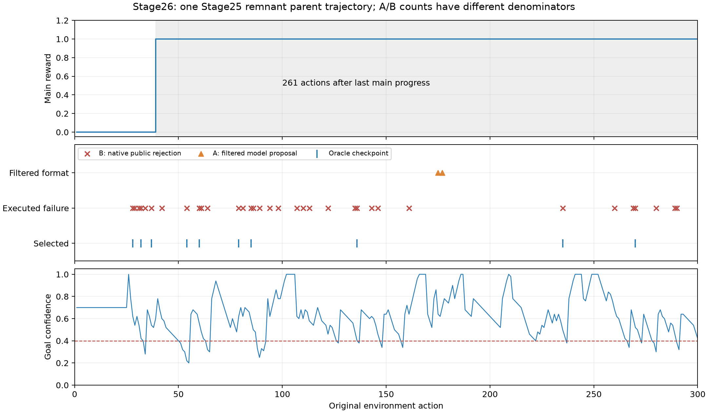

# Action Failure Replay：完整母轨迹审计

数据只有 Stage25 remnant seed42 一条母轨迹：300个实际动作、324个模型提案，主线奖励1，未完成第一章。每一步的观察、当前目标、全部提案、实际执行、反馈、下一观察和进度变化已写入 `results/stage26/action_failure_replay.jsonl.gz`，与原始轨迹行号一一对应。

| 类别 | 数量 | 比例及分母 | 典型证据 |
|---|---|---|---|
| A 格式/接口错误 | 3个提案，涉及2个决策 | 0.93%，分母324个模型提案 | a175一次、a177两次write quiet；均在环境执行前被拒 |
| B 状态/前置条件不满足 | 34 | 11.33%，分母300个执行动作 | a54手满；a60缺工作台；a136没拿写字工具 |
| C 连续同动作/同公开上下文失败 | 1 | 0.33%；占34个B类失败的2.94% | a31→32重复lockpick library；C与B重叠 |
| D 严格8步无新公开信息代理 | 0 | 0/300 | 没有满8步连续零新信息；不能据此断言无规划停滞 |

这不是四个互斥分箱。A使用提案分母，B/C/D使用执行动作分母，C包含在B中；不能把表中数量或百分比直接相加。原生 `step_invalid_action` 为0，34次是公开反馈中的语义拒绝，不能把二者混为一谈。

| B子类 | 数量 | 占34个实际失败 |
|---|---|---|
| locked_exit | 6 | 17.6% |
| missing_lockpick_tool | 2 | 5.9% |
| object_not_held_or_visible | 2 | 5.9% |
| hand_capacity | 11 | 32.4% |
| missing_workbench | 1 | 2.9% |
| combat_blocks_exit | 5 | 14.7% |
| not_equippable | 2 | 5.9% |
| missing_writing_tool | 1 | 2.9% |
| insufficient_ingredients | 3 | 8.8% |
| container_capacity | 1 | 2.9% |

B描述已经观察到的环境拒绝原因，不一概指控Agent“明知状态还做错”：第一次缺工具/工作台反馈可能是在发现此前未知约束。只有当前可见条件或此前同上下文失败提供支持时，才谈失败经验利用。完整已公开前因、首个反馈和后续恢复可由逐步记录核查。

## 连续失败与恢复

连续任意失败区段共有7组：28–29、31–32、60–61、85–86、135–136、269–270、289–290，最长2步。严格同动作且同公开上下文的相邻重复只有a32；非连续同上下文复发还有a34重复a28的enter library，合计2个复发终点。没有三连相同失败。a289/a290虽然都制作paper失败，但数量参数不同，不能算“完全相同动作”。

| 失败动作 | 原动作 | 下一动作 | 首次后续被接受动作 | 相同动作20步内成功 | 后20步主线增量 |
|---|---|---|---|---|---|
| 28 | enter library | enter armory | 30 | 39 | 1 |
| 29 | enter armory | talk to bob_johnson | 30 | 46 | 1 |
| 31 | lockpick library | lockpick library | 33 | 无 | 1 |
| 32 | lockpick library | inspect key | 33 | 无 | 1 |
| 34 | enter library | inspect workbench | 35 | 39 | 1 |
| 37 | equip key | pick up key | 38 | 无 | 1 |
| 42 | enter armory | defend | 43 | 46 | 0 |
| 54 | pick up iron_bar | drop torch | 55 | 无 | 0 |
| 60 | craft 1 wood_plank | pick up stone | 62 | 无 | 0 |
| 61 | pick up stone | drop torch | 62 | 无 | 0 |
| 64 | enter plain | attack goblin_warrior_1 | 65 | 无 | 0 |
| 79 | enter hall | attack goblin_warrior_1 | 80 | 91 | 0 |
| 81 | enter hall | attack goblin_warrior_1 | 82 | 91 | 0 |
| 85 | equip torch | pick up small_satchel_0 | 87 | 无 | 0 |
| 86 | pick up small_satchel_0 | drop torch | 87 | 无 | 0 |
| 89 | pick up apple | enter library | 90 | 无 | 0 |
| 94 | enter library | attack goblin_warrior_2 | 95 | 无 | 0 |
| 98 | enter armory | attack goblin_warrior_2 | 99 | 无 | 0 |
| 107 | pick up goblin_eye | store 1 wooden_rod small_bag_0 | 108 | 109 | 0 |
| 110 | pick up cloth | store 1 goblin_eye small_bag_0 | 111 | 112 | 0 |
| 113 | take out wooden_rod small_bag_0 | drop cloth | 114 | 121 | 0 |
| 122 | equip wooden_rod | enter armory | 123 | 无 | 0 |
| 135 | pick up small_satchel_0 | write quiet paper_7 | 137 | 无 | 0 |
| 136 | write quiet paper_7 | enter library | 137 | 无 | 0 |
| 143 | pick up cloth | store 1 cloth small_bag_0 | 144 | 145 | 0 |
| 146 | pick up cloth | store 1 cloth small_bag_0 | 147 | 151 | 0 |
| 161 | enter hall | attack peak_vulture_0 | 162 | 无 | 0 |
| 235 | craft 1 torch | enter library | 236 | 无 | 0 |
| 260 | enter plain | enter hall | 261 | 无 | 0 |
| 269 | pick up cloth | store 1 cloth small_satchel_0 | 271 | 无 | 0 |
| 270 | store 1 cloth small_satchel_0 | drop cloth | 271 | 无 | 0 |
| 280 | inspect paper_7 | enter armory | 281 | 无 | 0 |
| 289 | craft 1 paper | craft 2 paper | 291 | 无 | 0 |
| 290 | craft 2 paper | inspect workbench | 291 | 无 | 0 |

首次后续动作被接受只证明结束了局部拒绝，不证明恢复主线。相同动作成功在20步内按完整动作字符串匹配，数量/目标变化不算相同；未出现不是宣称永久不可恢复。

## 主线停滞与合法动作

唯一主线增量在a39进入library。a40公开指引要求先武装再追寻ash；此后261步中，28步环境拒绝、233步动作被接受但无主线增量。全轨迹有265步“被接受但无主线增量”。这包括合理准备、战斗和生存，不能全标为无效动作；但它说明仅统计接口错误无法解释大多数后续预算。

严格D代理为0，是因为新敌人、战斗反馈和库存操作会不断产生新公开信息。另有56个≤8步公开状态回环终点，存在区段重叠，也包含教程规定操作；它们不是同样数量的独立失败循环。原始公开状态签名忽略时间/HP等变化，有状态回环不代表完整原生状态相同。所有区段在 `source_failure_statistics.json:short_public_state_cycles` 中保留。

a60制作wood_plank缺工作台；a85装备torch失败；a122装备wooden_rod失败；a130成功装备容器；a133成功制作torch；a136写字缺工具；a214最终成功写quiet；a235/289/290制作缺材料。Agent有时能恢复局部操作，但这些成功没有转化为第二个主线阶段。a82、209、257发生死亡，不能仅用低wait次数描述这段行为是有效探索。

观察层面的结论：**实际被拒动作主要是B类状态/前置条件错误；整局长期停滞不能等同于格式错误或连续重复失败。** 是否值得新增动作层，应结合[Oracle结果](OracleActionCorrection实验结果.md)，而非单凭失败次数选择模块。
