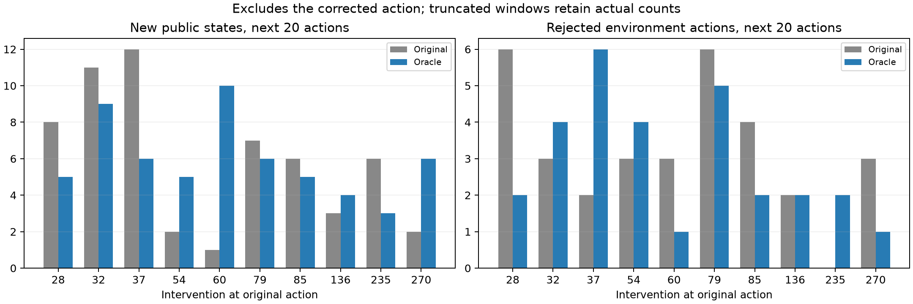
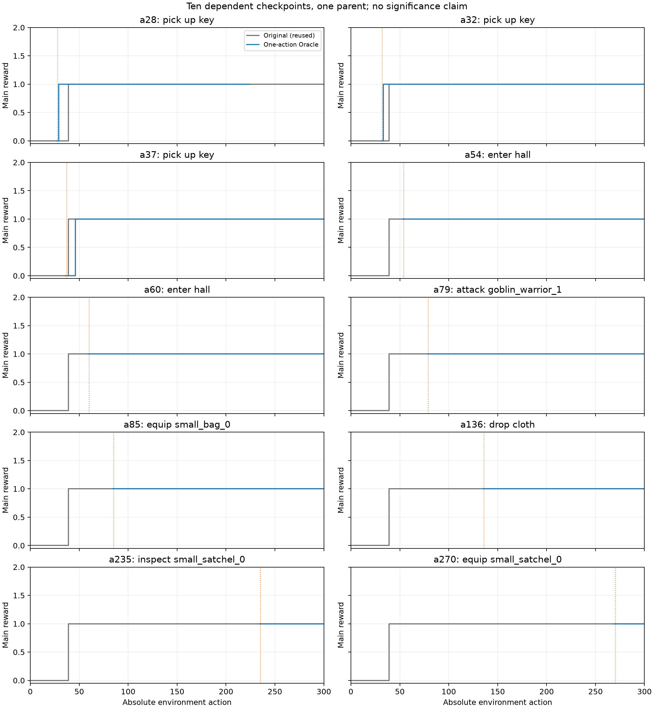

# Oracle Action Correction 实验结果

结论：**NO_CLEAR_LONG_TERM_RECOVERY**。10个单步Oracle分支均未增加最终主线奖励，第一章仍为0/10。该干预没有恢复长期任务推进；它不排除连续动作纠错或更好的状态理解可能有效。

| 检查点 | 失败类型 | 剩余动作预算 | Original主线 | Oracle主线 | 差值 | Oracle首章 | Oracle动作 | 终止 |
|---|---|---|---|---|---|---|---|---|
| 28 | locked_exit | 273 | 1 | 1 | 0 | 否 | 197 | agent_decision_exhausted |
| 32 | repeated_missing_tool | 269 | 1 | 1 | 0 | 否 | 269 | step_limit |
| 37 | object_not_held | 264 | 1 | 1 | 0 | 否 | 264 | step_limit |
| 54 | hand_capacity | 247 | 1 | 1 | 0 | 否 | 247 | step_limit |
| 60 | missing_workbench | 241 | 1 | 1 | 0 | 否 | 241 | step_limit |
| 79 | combat_blocks_exit | 222 | 1 | 1 | 0 | 否 | 222 | step_limit |
| 85 | not_equippable | 216 | 1 | 1 | 0 | 否 | 216 | step_limit |
| 136 | missing_writing_tool | 165 | 1 | 1 | 0 | 否 | 165 | step_limit |
| 235 | insufficient_ingredients | 66 | 1 | 1 | 0 | 否 | 66 | step_limit |
| 270 | container_capacity | 31 | 1 | 1 | 0 | 否 | 31 | step_limit |

Original全部复用同一已验证母轨迹的对应后缀，新增模型调用0；Oracle只替换各分支的第一步。原始第一章为0/10，Oracle为0/10，全主线为0/10。配对主线：提高0、持平10、降低0。所有分支均列出，没有按结果删样本。

本轮a28分支在绝对决策225四次提出同一个非法 `pick up 10 coin`（接口不接受该数量参数），用尽3次额外动作重试。实际执行197个续跑动作，停在绝对a224，剩余76步未执行；其余9个分支到a300。四次均返回完整JSON且finish_reason=stop，不是传输或截断异常。该结果完整计入，未修复或重跑。 这说明Stage25原母轨迹“未被格式错误终止”不是可靠性保证。它是分支后续发生的A类提案错误，不能加进原母轨迹34个环境失败或误记为环境内四连失败。原始证据在 `runs/remnant_a028/Oracle/decision_exhausted.json` 与该局请求日志；重试本身仍没有生成有效动作。

10个检查点从a28到a270，剩余预算273至31步，不能把不同起点的绝对任务机会混在一起。原生阶段状态数按 `chapter:stage:complete` 的新增状态组合计算，仅用于离线评价；不把动态敌人击杀数量冒充主线子目标数。

## 同状态第一步和短期结果

每个Oracle第一步均从完全相同的原生状态、公开观察、记忆、目标和原模型提案出发。10个修正动作均被原生环境接受且没有即时死亡，这是预先筛选条件，不能作为“模块有效率100%”。即时主线奖励、HP变化、反馈和信息变化逐例见 `diagnostics.json:first_step`。

| 检查点 | 首步新信息 原/Oracle | 后续20步新状态 原/Oracle | 后续20步拒绝 原/Oracle | 后续20步回环 原/Oracle | 前20步主线增量 原/Oracle |
|---|---|---|---|---|---|
| 28 | 1/1 | 8/5 | 6/2 | 1/0 | 1/1 |
| 32 | 0/1 | 11/9 | 3/4 | 1/2 | 1/1 |
| 37 | 1/1 | 12/6 | 2/6 | 2/4 | 1/1 |
| 54 | 1/1 | 2/5 | 3/4 | 10/5 | 0/0 |
| 60 | 1/1 | 1/10 | 3/1 | 8/4 | 0/0 |
| 79 | 1/1 | 7/6 | 6/5 | 2/7 | 0/0 |
| 85 | 1/1 | 6/5 | 4/2 | 4/8 | 0/0 |
| 136 | 1/1 | 3/4 | 2/2 | 1/1 | 0/0 |
| 235 | 1/1 | 6/3 | 0/2 | 4/3 | 0/0 |
| 270 | 1/1 | 2/6 | 3/1 | 9/1 | 0/0 |

“后续20步”明确排除被修正的第一步，避免把保证通过的动作计作独立恢复证据；“前20步”包含替换动作。若因原生结束或冻结算法终止窗口不足，保留实际分母并标为censored，完整前5/20及后续5/20统计在 `paired_metrics.json:windows`。

局部效率也有正面结果：a28、a32分支的首次主线奖励分别在绝对a29、a33获得，比Original的a39提前10步和6步；a37分支却延后至a46。三个分支最终仍停在1。排除干预动作后的20步中，新公开状态数4个分支增加、6个减少；环境拒绝数5个减少、4个增加、1个持平；主线增量10个配对均相同。不能只展示短期改善分支。

只有1个检查点满足“Oracle首步有新公开信息、Original首步没有”；失败反馈本身也可能是新规则信息，不能把所有原生拒绝当作毫无信息价值。单步接受性与信息量不是同一个指标。

| 检查点 | 版本 | 前5步信息/实际动作 | 前20步信息/实际动作 | 新主线阶段状态数 | 后续动作总失败 | 末段无主线增量动作 |
|---|---|---|---|---|---|---|
| 28 | Original | 4/5 | 16/20 | 1 | 34 | 261 |
| 28 | Oracle | 5/5 | 20/20 | 1 | 32 | 195 |
| 32 | Original | 2/5 | 16/20 | 1 | 31 | 261 |
| 32 | Oracle | 5/5 | 20/20 | 1 | 61 | 267 |
| 37 | Original | 5/5 | 17/20 | 1 | 29 | 261 |
| 37 | Oracle | 4/5 | 14/20 | 1 | 41 | 254 |
| 54 | Original | 4/5 | 13/20 | 0 | 27 | 247 |
| 54 | Oracle | 4/5 | 17/20 | 0 | 40 | 247 |
| 60 | Original | 4/5 | 10/20 | 0 | 26 | 241 |
| 60 | Oracle | 4/5 | 13/20 | 0 | 43 | 241 |
| 79 | Original | 5/5 | 20/20 | 0 | 23 | 222 |
| 79 | Oracle | 5/5 | 20/20 | 0 | 30 | 222 |
| 85 | Original | 5/5 | 20/20 | 0 | 21 | 216 |
| 85 | Oracle | 5/5 | 16/20 | 0 | 25 | 216 |
| 136 | Original | 5/5 | 10/20 | 0 | 11 | 165 |
| 136 | Oracle | 5/5 | 13/20 | 0 | 20 | 165 |
| 235 | Original | 3/5 | 16/20 | 0 | 7 | 66 |
| 235 | Oracle | 2/5 | 8/20 | 0 | 8 | 66 |
| 270 | Original | 2/5 | 9/20 | 0 | 4 | 31 |
| 270 | Oracle | 3/5 | 15/20 | 0 | 2 | 31 |

## 长期结果

单步改变可以改变后续信息、动作失败和路径，但这些指标与主线成功不等价。Original的主线最终为1，不代表每个检查点后都有1点新增：a39之前的检查点原后缀包含一次主线增量，a39之后的原后缀增量为0。所有指标从同一检查点的公开前缀初始化，避免把已知观察当作新发现。

## 可归因范围

同状态原生第一步的差异可以归于这一次动作替换；后续LLM因新反馈重新采样，供应商没有可锁定的采样种子，Original又复用旧样本，所以不能将所有长期差值都精确归于动作替换。10个分支共享一条母轨迹和相互重叠的原始后缀，不是10个独立任务或随机试验，不做显著性检验。

Oracle只保证当步可接受，不保证完成原动作的全部前置条件，也不保证最优选择。a136只丢cloth腾一只手，a235只检查容器；它们不是持续的动作可行性层。为严格保持memory，控制器已写入STM的原提案未重写，下一步通过真实反馈感知执行结果，短期存在一条提案/执行不一致记录。阴性结果只否定“这组单次合法动作替换足以恢复”，不能证明所有动作纠错无价值或规划缺陷已被唯一隔离。
