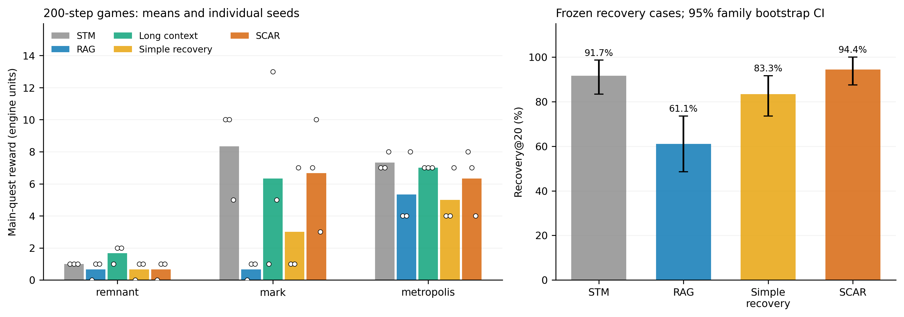
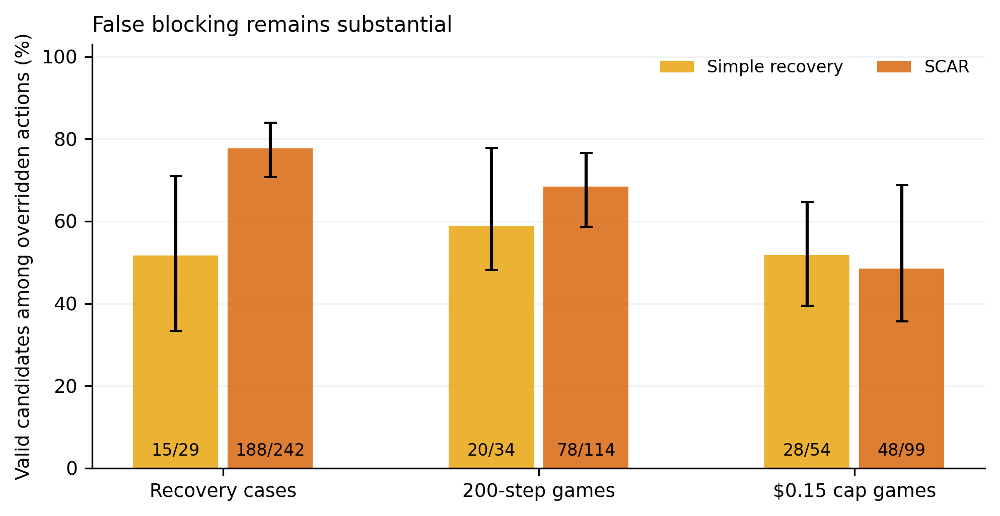

# SCAR / AgentOdyssey 实验报告

实验日期：2026 年 10 月 11 日（北京时间）。所有表格来自服务器上的真实 DeepSeek 调用及 AgentOdyssey 执行，没有模拟结果。代码、冻结配置、逐局指标和分析文件随本报告提交；第三方代码、模型、凭据和大型原始快照保留在仓库之外。

## 1. 研究判断：PARTIAL，局部恢复有效，整体优势尚未成立

完整 SCAR 在冻结诊断集上的 Recovery@20 为 **68/72（94.44%）**，简单失败恢复为 **60/72（83.33%）**，官方 STM 为 **66/72（91.67%）**。相对简单恢复提高 11.11 个百分点，按 36 个状态 family 聚类的配对 bootstrap 95% 区间为 **[1.39, 20.83] 个百分点**；相对 STM 的差值为 2.78 个百分点，区间 **[-2.78, 8.33]**，不能确认优势。

这一局部收益没有转化为稳定的长期任务优势。200 步实验中，SCAR 的平均主线奖励为 **4.56**，低于 STM 的 **5.56**；相对简单恢复的均值优势在另一批统一预算上限实验中反转。全部 90 局正式长程/预算实验均未触发引擎主线通关标志。

误拦截是当前版本的主要问题：诊断实验中，SCAR 改写了 242 个基础候选，其中 **188 个原本可执行，FBR 为 77.69%**；其中 107 次进一步变成被拒绝的执行动作。该口径包含修复计划接管候选，并非只统计硬规则禁令，因此不能把全部替换都解释为错误记忆；但反事实执行审计确实发现了不必要的失败。冻结开发规则迁移到测试状态的 CRA 仅 **14.23%**，规则适用覆盖极低。

因此，本轮支持“SCAR 对部分已知可恢复子目标有局部作用”，**不满足 GO 所要求的稳定主线收益与误拦截控制**，也不支持整体优于官方 STM。现有结果尚不宜支撑扩大规模或部署；下一轮若继续研究，应先处理条件变化后过早重试与规则迁移问题，再重新冻结独立测试。本轮没有依据测试成绩修改算法，也没有补做消融或参数搜索。

左图每个点是一个实际游戏种子，柱为三个种子的均值；右图为 72 个诊断状态、36 个 family 的均值与 bootstrap 区间。family 来源于仅 6 条自然采集轨迹，区间不能代表广泛任务分布上的不确定性。

## 2. 完成情况与全部运行记录

| 阶段 | 运行数 | 实际环境动作数 | 结束情况 | 已知 usage 估算费用（美元） |
|---|---:|---:|---|---:|
| smoke（含最初失败尝试） | 27 | 300 | 15 完成，12 开发期故障 | 0.103206 |
| pilot，种子 7 | 15 | 1,800 | 全部完成 | 0.902079 |
| 官方 STM 自然采集，404/505 | 6 | 720 | 全部完成 | 0.406385 |
| 早期诊断预运行，排除于正式比较 | 73 | 1,460 | 全部结束，因重放修正整体作废于正式比较 | 0.889120 |
| 冻结正式诊断 | 288 | 5,760 | 全部完成 | 3.162033 |
| 200 步长程 | 45 | 9,000 | 全部完成 | 4.721781 |
| 每局 $0.15 上限、最多 200 步 | 45 | 8,950 | 41 达步数上限，4 按预算规则停止 | 4.647302 |

正式比较共 **378 次运行**，没有任务故障或全局预算停止。全阶段共 499 条运行记录；12 个失败记录全部来自最初 smoke，实现修复后保留原记录，没有选择性删除。`completed` 表示按实验终止规则执行完毕，**不表示游戏通关**。

正式诊断 API 执行窗口约为 17:43:18–18:13:38；长程为 18:45:51–19:07:37，约 21.77 分钟；预算实验为 19:07:41–19:29:23，约 21.70 分钟。窗口由首个请求至最后响应计算，不含前后少量初始化与汇总时间。阶段间等待不计入单局耗时。

完整记录见 [all_runs.csv](../results/all_runs.csv)、[all_summaries.json](../results/all_summaries.json)、[stage_accounting.json](../results/stage_accounting.json) 和 [incomplete_runs.csv](../results/incomplete_runs.csv)。预运行指标也保留，但不用于以下正式结论。

## 3. 平台、模型与冻结配置

- 服务器实测 16 个逻辑 CPU、65,035,087,872 字节内存（约 60.57 GiB），没有可用 CUDA；Python 3.12.15、PyTorch 2.14.1+cpu。版本清单见 [server_environment.json](../results/server_environment.json) 和 [requirements-cpu.lock](../requirements-cpu.lock)。
- 官方 [AgentOdyssey](https://github.com/agentodyssey/agentodyssey) 固定到 `248430692a9d4a61d38c6c03ab2126287faaf450`，服务器检查上游受版本控制的文件无改动。
- 所有 LLM 方法统一调用 `deepseek-flash`、`https://api.deepseek.com`、非思考模式、temperature=0.7、max_tokens=768、JSON 输出。详见 [protocol.json](../configs/protocol.json)；[官方思考模式参数](https://api-docs.deepseek.com/guides/thinking_mode/)由统一 provider 设置。
- VanillaRAG 使用官方实现与默认 `Qwen/Qwen3-Embedding-0.6B`，权重版本固定为 `97b0c614be4d77ee51c0cef4e5f07c00f9eb65b3`，CPU 编码和检索，没有削弱基线。
- 开发种子为 7；诊断自然采集种子 404/505；长程和预算实验各使用 101/202/303。官方 STM 窗口为 5。LongContext 保留完整历史，未开启额外 reflection 或 summarization。
- 正式实验统一 `PYTHONHASHSEED=0`，OpenMP/BLAS 线程数为 1，最多 16 个独立游戏进程。每局有独立环境、研究记忆和日志；全局只共享 API 并发门控与预算账本。
- 冻结核心实现 SHA-256：`54dee4e43d49bcbdec7336b923ea5032cc5fbbe58e48554b200eacec11e862d9`。正式长程/诊断任务后缀为 `a4071afb3023`；预算任务因增加单局预算参数，后缀为 `bdb1473ed6bc`。版本记录见 [formal_freeze.json](../results/formal_freeze.json)。此后只补充分析、图表、后台调度脚本和文档，没有修改冻结策略。

基线使用真实官方工厂；兼容层补齐上游 STM 配置缺少的 `construct_user_prompt_long_context`，格式与官方 LongContext 一致，并统一应用于 STM、SCAR 和 Simple。最初缺少该方法及 checkpoint memory 目录导致的 12 个 smoke 故障均有记录。SCAR/Simple 会把 STM 记忆条目改为观察、基础候选与实际执行动作，防止记忆记录错误动作；这与官方 STM 保留 reasoning 的格式不同，也是 token 与性能比较的潜在混杂。

本研究遵循[官方 Agent 接口](https://agentodyssey.github.io/docs/agent/implementing-agents)及[评测指标](https://agentodyssey.github.io/docs/evaluation-metrics)接入，但使用 DeepSeek 和 200 步上限，**不属于官方 Challenge 排名复现**。原论文入口为 [AgentOdyssey](https://arxiv.org/abs/2606.24893)。

## 4. 实际实现及运行证据

| 模块 | 实际行为 | 代码 |
|---|---|---|
| A 失败检测 | 仅从公开观察与反馈提取动作、位置、目标、原因、证据和可信度；未知原因保持低置信度 | [detection.py](../scar/agents/scar/detection.py)、[state.py](../scar/agents/scar/state.py) |
| B 条件记忆 | 按动作、条件和原因合并；保留证据、作用范围、置信度、成功/失败验证；最多 256 条规则 | [memory.py](../scar/agents/scar/memory.py) |
| C 局部修复 | 基础候选后查询记忆；必要时一次额外模型调用，安装最多 3 步的实际动作队列，逐步检查和调整 | [repair.py](../scar/agents/scar/repair.py)、[agent.py](../scar/agents/scar/agent.py) |
| D 更新/重试 | 条件变化或 8 步冷却后允许试探；成功证据更新规则，矛盾证据降低置信度，不永久禁用 | [memory.py](../scar/agents/scar/memory.py)、[repair.py](../scar/agents/scar/repair.py) |
| 简单恢复 | 最近 20 条失败、相同可观察状态缓存、8 步冷却、一次普通 LLM 重规划；不使用 SCAR 规则库和修复队列 | [simple_recovery.py](../scar/baselines/simple_recovery.py) |

Simple 的“暂时阻止”通过触发一次重规划及向模型列明失败动作实现；若重规划仍选同一动作，执行它并如实计分，没有免费无限重采样或隐式等待。SCAR 同样保留有限验证回退。两者所有额外模型请求、拒绝动作和信息动作均计入费用与步数。

正式长程 SCAR 日志记录到：390 次失败学习事件、88 次修复计划事件、114 次候选替换、32 次记忆命中、19 次冷却试探、1 次规则矛盾更新。四模块确实在运行中触发，不能据此推导四模块各自的因果收益。诊断的模块事件含对共同历史的记忆重放，规则更新也可能对多条规则分别记数，不能将事件总数当成独立恢复次数。完整分组记录见 [scar_module_events.csv](../results/scar_module_events.csv)。

策略不读取 `invalid_action`、引擎隐藏状态、可行动作 oracle 或恢复见证。隐藏状态只用于离线造例、反事实评分和真实目标判定。快照剥离 provider/凭据，研究记忆另存；每步最后写 checkpoint 完成标记，以完整步骤恢复。异常 JSON/请求最多 3 次尝试，不静默替换为默认 wait；上游对语法错误动作自行执行的默认行为则作为真实环境结果保留并计为无效动作。

## 5. AO-FR 构造、覆盖及限制

从官方 STM 的开发及新种子轨迹共检查 1,080 个动作，其中语义拒绝 210 次（19.44%）。同等可观察状态下重复拒绝 12 次（占动作 1.11%）；97 个失败事件后来出现状态变化后的同动作非拒绝执行；52 个失败未被我们的原因解析器明确分类。后两项是重叠事件计数，**不分别等于 97 个独立 B 案例或 52 个已验证 C 案例**；自然替代路径频率未完成独立标注，记录为不可得。[原始频率汇总](../results/natural_frequencies.json)

造例使用真实引擎状态和通用动作搜索，最多 80 个节点、最多 2 个前置动作加目标动作，每层最多检查排序后的 24 个候选。候选按固定种子 8675309 打乱、family 去重，选取前 120 个通过验证的状态记录。已处理候选中有 33 个未找到有界恢复见证，排除于恢复分母，不能据此说它们理论上不可恢复。每个保留案例通过两次独立见证重放；冻结后再次验证全部 120 个。此搜索和截断使数据偏向短而可验证的恢复链，不能代表全部自然失败。[构造与验证记录](../results/dataset_validation.json)

| 划分 | 状态数 | family 数 | 来源 |
|---|---:|---:|---|
| 开发 | 48 | 24 | 种子 7 的失败及条件解除变体 |
| 冻结测试 | 72 | 36 | 404/505 的 36 个自然失败状态 + 36 个引擎执行前置动作生成的条件解除变体 |

测试集中 remnant 26 个状态、mark 26 个、metropolis 20 个，来源于 6 条采集轨迹。A/D 共用 36 个母状态，B 为其 36 个解除条件变体，**C 为 0**。A 表示可测试重复失败的状态，并不声称全部母状态在自然轨迹中已经重复失败；D 表示已验证的前置条件行动链，不是验证过的不同地图路线。A 与 D 不能相加作为 72 个独立场景。

母案例历史以自然失败结束；B 变体通过执行见证前缀解除障碍，并把这些公开交互加入所有方法共同获得的历史。原始案例中 B 的 `source="natural"` 继承母案例，指失败来源，**不代表变体初始状态天然出现于原轨迹**；[dataset_provenance.json](../results/dataset_provenance.json) 明确区分 `natural_failure_snapshot` 与 `engine_condition_release_variant`。

所有 120 个初始状态都尚未达到恢复目标。[初始目标审计](../results/initial_goal_audit.json)；与 46 个开发 family 比较，测试/开发 family 重叠为 0，但仍共享游戏机制。冻结案例 JSON 的摘要为 `32d93088946b4f92286b317add2ee2166398391b93bb5a7bd1631c72f17d3ad6`。测试运行前没有把隐藏真值或见证动作给策略。

## 6. 指标口径与统计

- **Recovery@K**：首次在 K 个实际环境步内满足预定义物理目标，例如进入指定地点、增加指定物品持有量或装备量。没有再尝试失败动作不算恢复。每个正式诊断继续执行完整 20 步，所以失败率与 FBR 包含恢复后的动作；恢复成本另截取至首次恢复。
- **官方 IAR/RIAR**：采用引擎 `step_invalid_action`。该标记主要涵盖语法、参数与解析错误；不能替代语义拒绝率。
- **语义拒绝/语义 RIAR**：在独立引擎副本派发真实动作规则，仅取动作阶段反馈，排除后续 NPC/tutorial 文本。对明确拒绝用固定文本规则识别。RIAR 为同一规范化动作、同一观察摘要下重复失败数除以执行步数；不是任意语义等价动作或完整隐藏状态等价。
- **FBR**：所有被改变的基础候选中，在反事实引擎副本上可执行的比例。包括修复计划接管；合法动作被替换不必然有害，另列“合法候选被替换为拒绝动作”的次数。零拦截方法的 FBR 为不适用，不写成 0%。报告使用事件汇总比例；`aggregate.csv` 中的 `fbr_mean` 是有拦截运行的宏平均，两者不要混用。
- **CRA**：仅用开发 pilot 学到的冻结规则，在测试状态预测；无匹配规则按允许处理。在线每 10 步至多 10 条规则审计为探索性数据，不能替代冻结 CRA。
- **主线奖励/通关**：直接取引擎 quest reward 与 `main_quest_complete` 终止标志。里程碑预定义为首次获得正的 quest reward，包含教程进展；仅在达到者中统计步数，并列出分母。

配对比较按相同诊断案例或相同游戏/种子进行，bootstrap 10,000 次，种子 314159。诊断按 family 聚类，长程按游戏/种子配对。`independent_groups` 是统计脚本的簇数名称，**不表示 36 个 family 在机制或来源上独立**。另提供以 6 条源轨迹为簇、各轨迹等权的探索性敏感性分析。只有每游戏 3 个种子，远程模型仍随机；区间描述当前样本，不作多重比较后的显著性宣称。跨游戏奖励均值未做尺度归一化，只作描述；应同时看逐游戏结果。

## 7. 冻结诊断结果

| 方法（各 72 例） | Recovery@10 | Recovery@20 | 官方 IAR | 语义拒绝率 | 语义 RIAR | FBR（计数） |
|---|---:|---:|---:|---:|---:|---|
| STM | 65/72，90.28% | 66/72，91.67% | 0.69% | 23.19% | 1.04% | 不适用 |
| RAG | 37/72，51.39% | 44/72，61.11% | 0.35% | 22.85% | 4.17% | 不适用 |
| Simple | 60/72，83.33% | 60/72，83.33% | 0.63% | 22.08% | 0.07% | 15/29，51.72% |
| SCAR | 66/72，91.67% | 68/72，94.44% | 0.28% | 25.56% | 0.28% | 188/242，77.69% |

四种方法诊断中的官方 RIAR 均为 0。SCAR 相对 STM/RAG 降低了重复语义失败，但没有优于 Simple 的 0.07%；SCAR 的总语义拒绝率反而最高。恢复目标达成与整段行动质量必须分别理解。

| SCAR − 基线 | Recovery@20 配对差值 | 36 family 的 95% 区间 | 6 源轨迹等权敏感性：差值 [区间] |
|---|---:|---:|---:|
| STM | +2.78 个百分点 | [-2.78, +8.33] | +2.93 [-2.08, +9.52] |
| Simple | +11.11 个百分点 | [+1.39, +20.83] | +11.81 [+4.86, +18.75] |
| RAG | +33.33 个百分点 | [+20.83, +45.83] | +33.79 [+25.87, +42.26] |

源轨迹等权改变了估计目标，因此点估计略有不同；仅 6 个簇的 bootstrap 也不足以支撑广泛泛化结论。

### 条件解除与前置链恢复

| 方法 | A/D 前置链 Recovery@20（36 例） | B Recovery@20（36 例） | B 原动作被接受 | B 原动作执行且物理目标已恢复 |
|---|---:|---:|---:|---:|
| STM | 33/36 | 33/36 | 33/36 | 33/36 |
| RAG | 22/36 | 22/36 | 22/36 | 22/36 |
| Simple | 27/36 | 33/36 | 34/36 | 33/36 |
| SCAR | 33/36 | 35/36 | 35/36 | 35/36 |

预定义 `successful_retry_steps` 只要求原动作没有被拒绝。补充的真实目标核对发现 Simple 有 1 个“动作被接受但未恢复目标”的 B 案例，因此不能把 34/36 当成真实正确恢复率。该补充审计保留原指标，并明确另列更严格的目标条件，见 [goal_verified_retries.json](../results/goal_verified_retries.json)。SCAR 的结果支持其在多数条件解除案例中没有永久封锁动作，但不意味着所有安全重试选择正确。

D 场景的 SCAR 33 次成功均通过最终重试原动作达到目标；“不执行原动作而先达到相同目标”的实际次数为 SCAR 0/36、STM 0/36、Simple 1/36、RAG 1/36。这不能被宣传为发现复杂替代地图路线。

### 误拦截与冻结规则

图中数字为“原本可执行的候选数 / 全部被改写候选数”；区间为补充的比例 bootstrap。正式诊断 SCAR FBR 的 95% 区间为 [70.71%, 83.93%]，Simple 为 [33.33%, 70.97%]。长程 SCAR 为 78/114（68.42%），预算实验为 48/99（48.48%）。

| 阶段 | SCAR：合法候选→拒绝动作 | Simple：合法候选→拒绝动作 |
|---|---:|---:|
| 诊断（各 1,440 步） | 107 | 4 |
| 长程（各 1,800 步） | 39 | 3 |
| 预算（两方法各 1,800 步） | 20 | 7 |

SCAR 的诊断 107 次中有 77 次来自 `safe_retry` 接管；长程 39 次中有 30 次来自该分支。这是在相同状态副本上验证的行为退化，不是 LLM 主观评分。不过，严格归因于“错误记忆”而非“计划执行/候选生成”的因果次数不可识别；本轮未做消融，不能把上述次数全部归给某一个模块。[intervention_outcomes.csv](../results/intervention_outcomes.csv)

冻结开发规则在 72 个测试状态上共有 1,890 个规则—状态预测：正确 269，CRA **14.23%**。预测拒绝仅 4 次，其中真拒绝 3、误拒绝 1；其余 1,886 次预测允许中，真可执行 266、实际拒绝 1,620。拒绝预测覆盖仅 **0.21%**，因此“匹配时 3/4 正确”没有可靠样本支持。无匹配视为允许使该测量同时反映跨状态覆盖缺失，不能把 14.23% 解释为局部已匹配规则的准确率；但它确实不支持当前知识库能作为可迁移的通用可执行性预测器。[rule_accuracy_frozen.json](../results/rule_accuracy_frozen.json)

## 8. 200 步长程实验

每个游戏、每种方法 3 个种子；45 局均真实执行到 200 步，通关率均为 0/9。

| 方法 | remnant 均值 | mark 均值 | metropolis 均值 | 全部 9 局均值 / 中位数 | 官方 IAR | 语义 RIAR |
|---|---:|---:|---:|---:|---:|---:|
| STM | 1.00 | 8.33 | 7.33 | 5.56 / 7 | 0.67% | 1.50% |
| RAG | 0.67 | 0.67 | 5.33 | 2.22 / 1 | 0.78% | 6.78% |
| LongContext | 1.67 | 6.33 | 7.00 | 5.00 / 5 | 0.06% | 0.50% |
| Simple | 0.67 | 3.00 | 5.00 | 2.89 / 1 | 1.17% | 0.94% |
| SCAR | 0.67 | 6.67 | 6.33 | 4.56 / 4 | 0.89% | 0.44% |

SCAR − Simple 的主线奖励配对差值为 **+1.67，95% 区间 [-0.89, +4.33]**；SCAR − STM 为 **-1.00，区间 [-2.11, 0.00]**；SCAR − LongContext 为 **-0.44，区间 [-1.89, +1.33]**。当前样本没有稳定的主线优势证据。SCAR 相对 STM 的语义 RIAR 下降 1.06 个百分点，区间 [-2.06, -0.33]，但总语义拒绝率为 21.67%，高于 STM 19.83% 和 Simple 19.50%。

首次正主线奖励：SCAR 8/9 局达到，达到者平均 28.0 步、中位数 33.5；STM 9/9、44.3/38；Simple 8/9、24.4/35；RAG 7/9、20.3/31；LongContext 9/9、24.9/33。到达者条件均值受幸存者选择影响，不能用 SCAR 的 28 步对 STM 的 44 步单独宣称更快。

### 逐种子奖励，避免只看均值

以下每格按种子 **101 / 202 / 303** 排列。

| 方法 | remnant | mark | metropolis |
|---|---|---|---|
| STM | 1 / 1 / 1 | 10 / 10 / 5 | 7 / 7 / 8 |
| RAG | 0 / 1 / 1 | 0 / 1 / 1 | 4 / 4 / 8 |
| LongContext | 1 / 2 / 2 | 1 / 13 / 5 | 7 / 7 / 7 |
| Simple | 0 / 1 / 1 | 1 / 1 / 7 | 4 / 4 / 7 |
| SCAR | 0 / 1 / 1 | 7 / 10 / 3 | 8 / 7 / 4 |

## 9. 统一 API 预算上限实验

这 45 局是重新实际运行的独立轨迹，不是截取长程曲线。每局上限 $0.15、最多 200 步。请求前按输入 UTF-8 字节上界与最大输出预留费用；余额不能覆盖预留上界即停止，即使实际已花费用尚低于 $0.15。因而这是**相同预算上限**，不是相同实际支出或相同 token 总量。

| 方法 | remnant 均值 | mark 均值 | metropolis 均值 | 全部均值 / 中位数 | 平均执行步数 | 平均 API 费用 |
|---|---:|---:|---:|---:|---:|---:|
| STM | 1.00 | 8.67 | 7.00 | 5.56 / 7 | 200.00 | $0.116584 |
| RAG | 0.67 | 0.33 | 5.00 | 2.00 / 1 | 200.00 | $0.095553 |
| LongContext | 1.00 | 10.33 | 7.33 | 6.22 / 7 | 194.44 | $0.088780 |
| Simple | 1.00 | 7.00 | 6.67 | 4.89 / 7 | 200.00 | $0.116643 |
| SCAR | 1.00 | 5.00 | 6.33 | 4.11 / 4 | 200.00 | $0.098808 |

4 个按预算规则停止的任务全部为 LongContext：remnant/303 在 197 步，metropolis/101、202、303 分别在 190、181、182 步；其余 41 局到达 200 步。实际已知费用约 $0.082–$0.133；长上下文的保守请求预留造成较多未消费余额。这限制了该实验作为“精确等成本”比较的力度。

SCAR − Simple 奖励差 **-0.78，95% 区间 [-2.22, +0.56]**；SCAR − STM **-1.44，[-3.11, 0.00]**；SCAR − LongContext **-2.11，[-4.56, -0.11]**。SCAR 的语义 RIAR 为 0.33%，Simple 为 0.17%，STM 为 0.72%。两批实验中相对 Simple 的奖励方向反转，不能把长程批次的较好均值当作稳定优势。由于远程 LLM 随机且大多数局预算不构成终止约束，也不能把两批差值全部归因于预算条件。

| 方法 | remnant（101 / 202 / 303） | mark | metropolis |
|---|---|---|---|
| STM | 1 / 1 / 1 | 7 / 9 / 10 | 7 / 7 / 7 |
| RAG | 0 / 1 / 1 | 1 / 0 / 0 | 7 / 4 / 4 |
| LongContext | 1 / 1 / 1 | 13 / 13 / 5 | 7 / 8 / 7 |
| Simple | 1 / 1 / 1 | 7 / 7 / 7 | 8 / 4 / 8 |
| SCAR | 1 / 1 / 1 | 7 / 3 / 5 | 4 / 7 / 8 |

## 10. 恢复与完整运行成本

### 至首次恢复或 20 步上限

所有 72 个案例进入成本分母，失败案例计满实际 20 步；成功者恢复步数另列，不能只看成功者来比较整体效率。

| 方法 | 恢复/截尾步数均值 / 中位数 | 成功者恢复步数均值 / 中位数 | 输入 / 输出 token 均值 | API 请求均值 | 费用均值 / 中位数 |
|---|---:|---:|---:|---:|---:|
| STM | 3.82 / 2 | 2.35 / 2 | 7,016 / 313 | 3.82 | $0.001517 / $0.000346 |
| RAG | 10.86 / 9.5 | 5.05 / 2 | 22,286 / 876 | 10.86 | $0.006034 / $0.004943 |
| Simple | 4.90 / 2 | 1.88 / 2 | 10,362 / 477 | 6.26 | $0.002432 / $0.000580 |
| SCAR | 3.54 / 2 | 2.57 / 2 | 8,029 / 444 | 4.68 | $0.001955 / $0.000967 |

SCAR 恢复前缀费用相对 STM 约增加 28.84%，相对 Simple 约减少 19.64%。完整 20 步诊断的费用均值则是 SCAR $0.011037、STM $0.010636、Simple $0.010953、RAG $0.011291；不能将整段费用称为恢复所需费用。[recovery_cost_by_algorithm.json](../results/recovery_cost_by_algorithm.json)

### 每局完整 200 步长程成本

| 方法 | 输入 / 输出 token 均值 | API 请求均值 | API 费用均值 | 单局真实耗时均值 / 中位数（秒） |
|---|---:|---:|---:|---:|
| STM | 354,529 / 17,474 | 200.44 | $0.117718 | 206.3 / 205.2 |
| RAG | 329,173 / 15,531 | 200.00 | $0.096504 | 655.5 / 645.0 |
| LongContext | 5,323,350 / 20,997 | 200.67 | $0.095366 | 245.4 / 246.5 |
| Simple | 360,890 / 18,975 | 240.11 | $0.116027 | 237.2 / 232.0 |
| SCAR | 311,831 / 16,656 | 210.00 | $0.099028 | 210.4 / 212.5 |

SCAR 相对 STM 请求约增加 4.77%，单局时间约增加 1.99%，但观测 token/费用更低；相对 Simple 请求少约 12.54%、费用少约 14.65%。这些是整套策略实测差异，包含记忆文本格式和轨迹变化，不能当作单独模块的净成本。

LongContext 输入很多却费用不高，原因之一是实际输入缓存命中率为 97.56%；STM 为 9.22%，SCAR 为 15.83%。统一计价使用实际返回的缓存命中/未命中 usage，不把所有输入按未命中价格重算，也不能据此说 LongContext 不耗上下文。该价格优势依赖本次服务端缓存行为。[cache_accounting_by_method.json](../results/cache_accounting_by_method.json)

耗时包含初始化、RAG 对共同历史的编码和 checkpoint 写入，不只包含模型决策。诊断 RAG 单局均值为 300.5 秒，而 SCAR 为 24.2 秒；相同历史在 RAG 中需要真实编码。CPU 开销没有计入 API 美元费用，未估算服务器租金；运行于共享并发资源下的时间也不是单机独占速度基准。

## 11. 典型轨迹与失败机制

以下例子按案例 ID 字典序分别选取“双方恢复 / 仅 SCAR 恢复 / 仅 Simple 恢复 / 双方未恢复”的首例，用于解释，不能替代总体统计。[paired_case_examples.json](../results/paired_case_examples.json)

- **双方恢复**，remnant，`0ac47b8b9d9c4162`：目标 `pick up shadow_ink`。两者均先放下 `goblin_eye` 再拾取目标，2 步恢复。这类手部容量前置条件可由简单恢复完成，不应全部归功于复杂知识库。
- **仅 SCAR 恢复**，metropolis，`2620fa57691526d5`：目标 `enter clerks_office`。SCAR 经移动、腾出空间、拿钥匙后第 6 步恢复；Simple 转向制作、搜集与对话，20 步内没有达到冻结目标。
- **仅 Simple 恢复**，mark，`3bc3f5216d2fb68e`：目标 `enter armory`。Simple 腾出空间、拿钥匙，第 4 步进入；SCAR 转向图书馆、木材和制作，未恢复目标。这说明修复计划也可能把行动带偏。
- **双方未恢复**，remnant，`123d5c83b6031221`：离线见证为放下火把、进入图书馆、拾取目标墨水，证明案例可恢复。两者仍被战斗/其它目标分散，SCAR 还多次重试拾取。这是有效失败样例，保留于分母。

明确的负面反事实例子：预算实验 `cost-SCARAgent-mark-101-bdb1473ed6bc` 第 38 步，基础候选 `pick up oak_log` 在状态副本上可执行，却被 `safe_retry` 替换为 `craft 1 oak_rod`；实际因缺少工作台被拒绝。长程同游戏/种子第 41 步，合法的 `enter library` 被替换为参数格式错误的旧 `write` 动作。当前“条件不再匹配或冷却到期即可允许重试”的逻辑没有证明真实前置条件已解除，也没有为旧目标动作提供足够的再次验证。[intervention_examples.json](../results/intervention_examples.json)

## 12. 可复现性、工程纠错与费用审计

服务器官方与项目测试共 **33 个主测试及 84 个子测试通过**；JUnit 文件按项目和子测试展开记录为 117 项，错误、失败、跳过均为 0。[server_tests.xml](../results/server_tests.xml)

早期诊断审计发现一个快照的 `objects_acquired` 顺序不同，原因是上游从集合遍历构造列表；该例观察与奖励一致，但严格状态摘要不一致。统一设置 `PYTHONHASHSEED=0` 后，**将此前全部 73 个诊断运行整体标记为 provisional**，保留日志、费用和指标，重新执行全部 288 个正式任务，没有按好坏成绩选择样本。相关冻结修订均留在 `formal_freeze_before_*.json` 和 Git 历史中；策略/provider 没有因这个修正而更换。

最终对 378 个正式任务及 6 个采集任务，每局抽查首、中、末三个已提交步骤，共 **1,152/1,152 精确重放**；对应 **384/384 初始状态**与冻结源一致。这是抽样重放，不声称逐步重放了所有 27,990 个环境动作。[replay_audit.json](../results/replay_audit.json)

费用按统一固定高峰单价估算：每百万缓存命中输入 $0.006、未命中输入 $0.30、输出 $1.20，来源为 [DeepSeek 官方定价](https://api-docs.deepseek.com/quick_start/pricing/)。这是实验比较口径，不是账户扣款账单，也未将可能适用的折扣当作确定已扣款。

全阶段运行请求 **29,814 次**，另有连通性 probe 1 次；其中失败/无效响应尝试 75 次，均保留并有限重试，HTTP 429 为 0。已返回 usage 共输入 **139,938,648**、输出 **2,515,591** token（不含 probe 的 46/12）。已知 usage 费用含 probe 为 **$14.831934282**；加上未知计费请求的保守预留，账本合计 **$14.834561382**，低于 $20 上限。初始 smoke/pilot 累计也低于 $3。[request_accounting.json](../results/request_accounting.json)、[audit_overview.json](../results/audit_overview.json)

资源监控最大 16 workers；最低可用内存约 38.54 GiB，最低磁盘余量约 35.26 GiB，未触及保护阈值。采样 CPU 峰值 97.2%；采样间隔随完成事件变化，不能把采样中位数当成时间加权平均占用。[resource_monitor_summary.json](../results/resource_monitor_summary.json)

## 13. 六个研究问题的回答

| 问题 | 本轮证据与回答 |
|---|---|
| 是否减少重复失败？ | 相对 STM/RAG 的语义 RIAR 通常下降；相对 Simple 不稳定，诊断和预算批次反而略高，不能说全面改善。 |
| 是否提高真实恢复？ | 冻结诊断相对 Simple 提高 8/72，相对 STM 仅提高 2/72且区间跨零；属于局部证据。 |
| 条件解除后能否重试？ | SCAR B 类 35/36 在原动作执行后达到真实目标，支持非永久禁用；大量其它安全重试仍造成拒绝。 |
| 是否提高主线/通关？ | 没有稳定证据；低于 STM 均值，所有方法正式长程/预算通关率均为 0。 |
| 增加多少成本？ | 长程相对 STM 请求约 +4.77%、耗时 +1.99%；恢复前缀费用约 +28.84%。整局费用因轨迹、记忆格式和缓存反而较低，不能视为固定的免费改进。 |
| 是否超过简单恢复，值得继续？ | 恢复目标上有增益，长期优势不稳、FBR 高、规则迁移弱。结论 PARTIAL；先解决已发现的问题，再决定是否值得投入更大实验。 |

主要限制：C 类未覆盖；短见证搜索与限额选择偏差；只有 6 条诊断来源轨迹及每游戏 3 个长程种子；观察摘要和语义文本标签不等于完整环境真值；A/D 标签重叠；多种方法记忆格式与上下文长度不同；服务端模型采样和缓存不可位级固定；成本上限对多数局不构成约束。本轮没有用额外游戏攻略、隐藏目标提示、主观 LLM 评分或挑选成功种子来修饰这些限制。

## 14. 交付与复现入口

- 我们的代码、配置、测试与分析：本仓库 `scar/`、`scripts/`、`tests/`、`configs/`、`results/`、`reports/`；[README](../README.md) 提供安装与执行命令。
- 服务器项目：`/root/scar_workspace/project`；Python 环境：`/root/scar_workspace/venv`。
- 原始实验：`/root/scar_workspace/runtime/runs/<task_id>/`，含请求审计、候选/执行动作、反馈、状态、记忆与不可覆盖的步骤 checkpoint。
- 冻结 AO-FR：`/root/scar_workspace/runtime/ao_fr_frozen/`，含完整案例、历史、快照、可达性见证和验证记录。
- 官方下载仓库和模型：`/root/scar_workspace/dependencies/`，不上传 GitHub。凭据、环境变量文件、SQLite 账本和 pickle 快照不进入 Git。

重跑分析可直接使用服务器保存的 runtime；重放相同测试应使用原冻结快照。重新调用 API 采集轨迹并重建数据集会产生新的实验，不能预期得到相同案例或相同数值。主指标和配对区间由 `scar.experiments.analyze` 生成，恢复前缀成本、来源簇敏感性和审计由 `scripts/` 对应程序生成；`posthoc_checks.py` 明确为补充分析，不替换预定义结果。原始轨迹均保留，最终结果应以原始已提交步骤和 usage 为审计依据。
